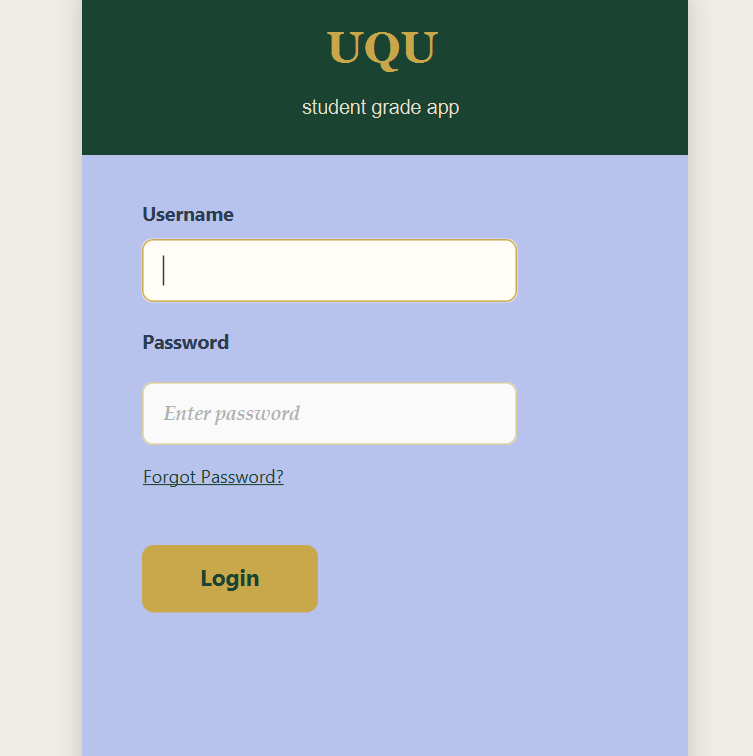
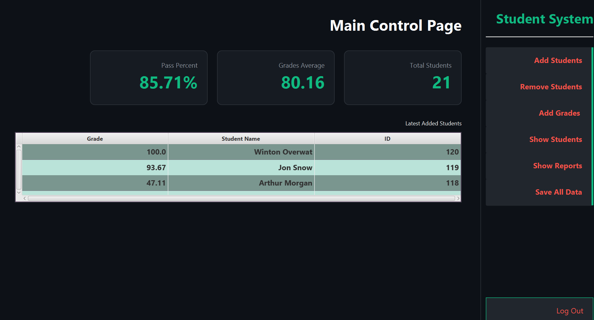
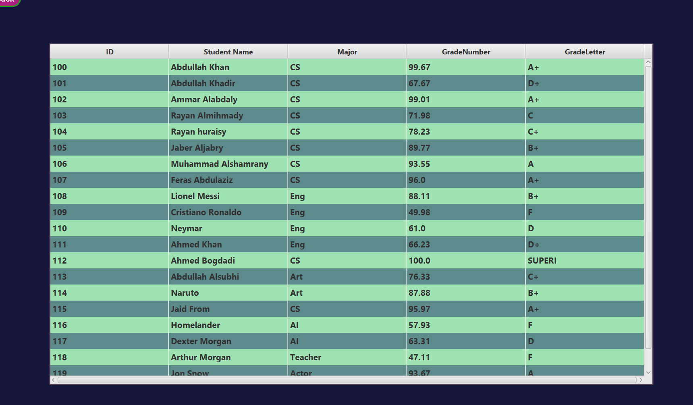
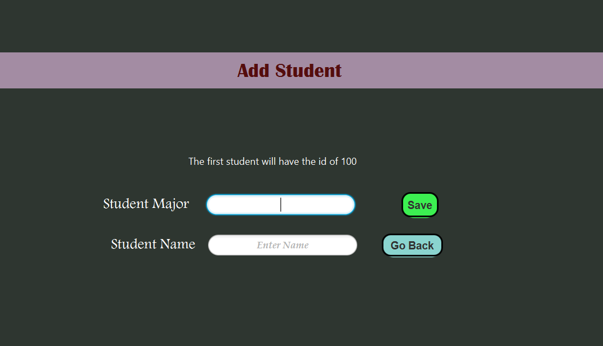

#  Student Management System

## 📸 Screenshots

### Login


### Dashboard


### Reports


### Add students


A desktop application built with **Java** and **JavaFX** to manage student records, organize academic information, assign grades, and generate student reports through a graphical user interface.

This project was developed as a simple student management system in which a moderator can manage student information and academic records. It uses **file-based storage and data structures** rather than a database.


## ✨ Features

- **📊 Dashboard:** A central screen for accessing the system's main functions.
- **👨‍🎓 Student Management:** Add, view, update, and manage student records.
- **📝 Grade Management:** Assign, edit, and review students' grades.
- **📑 Reports:** View student information and academic reports.
- **🗂️ File-Based Storage:** Store and retrieve information using files instead of a database.
- **🧱 Data Structures:** Organize and process application data in memory.
- **🖥️ Graphical User Interface:** Interact with the application through JavaFX screens.
- **🧩 MVC Design:** Separate the application's data, user interface, and control logic.

> The exact operations available depend on the screens and functionality implemented in the project.

## 🛠️ Technologies Used

| **Java** | Main programming language |
| **JavaFX** | Desktop graphical user interface |
| **Maven** | Dependency management and project build |
| **MVC Pattern** | Separation of application responsibilities |
| **File I/O** | Persistent file-based data storage |
| **Data Structures** | Organizing and managing data in memory |
| **IntelliJ IDEA** | Recommended development environment |

## 🏗️ Architecture

The project follows the **Model–View–Controller (MVC)** architectural pattern.

- **Model:** Represents student and grade data and handles the relevant data operations.
- **View:** Provides the JavaFX interface, including screens, forms, dashboard, and reports.
- **Controller:** Connects the interface to the application logic, handles user actions, and coordinates updates to the model.

This separation makes the code easier to understand, maintain, test, and extend.

## 💾 Data Storage

The project uses **local files and data structures** to manage information. It does **not** require a database server or a database installation.

- Files are used to save and retrieve data between application runs, where implemented.
- Data structures help organize and process records while the application is running.
- The application can be run locally without configuring a database connection.

**Note:** Keep a backup of any data files before making changes to the project. The exact file format and storage location depend on the implementation.

## ✅ Prerequisites

Before running the project, make sure you have:

- **Java JDK** compatible with the project's Maven configuration.
- **IntelliJ IDEA** (recommended).
- **Maven** — IntelliJ IDEA can usually import and manage Maven projects for you.
- **Git** (optional, if you want to clone the repository from the command line).

> **Java version:** Check the project's `pom.xml` for the configured Java version. If the version is specified there, use a compatible JDK in IntelliJ IDEA.

## 🚀 Getting Started

### 1. Clone the repository

```bash
git clone <https://github.com/Askelado/StudentSystem.git>
```

Alternatively, open the repository page on GitHub, select **Code**, and download the ZIP file.

### 2. Open the project in IntelliJ IDEA

1. Launch IntelliJ IDEA.
2. Select **Open**.
3. Choose the folder containing the project's `pom.xml`.
4. If prompted, choose to open or trust the project as appropriate.
5. Wait for IntelliJ IDEA to import the Maven project and download its dependencies.

### 3. Configure the JDK

1. Open **File → Project Structure → Project**.
2. Select a JDK compatible with the Java version configured in `pom.xml`.
3. Apply the changes.

### 4. Reload Maven

Open the **Maven** tool window in IntelliJ IDEA and click **Reload All Maven Projects** if dependencies have not loaded automatically.

### 5. Run the application

Use the run configuration provided by the project, if available.

If the project is configured with the JavaFX Maven plugin, you can usually run it from the Maven tool window using the configured JavaFX goal, or from a terminal:

```bash
mvn clean javafx:run
```

This command works when the project's `pom.xml` includes a compatible JavaFX Maven plugin configuration and the correct main application class.

> **If the command does not work:** Open `pom.xml` and check the Java version, JavaFX dependencies, JavaFX Maven plugin, and configured main class. The exact run command depends on this configuration.

## ▶️ Run the Project in IntelliJ IDEA

For the recommended IntelliJ IDEA workflow:

1. Open the project folder containing `pom.xml`.
2. Wait for Maven synchronization to finish.
3. Confirm that the Project SDK uses a compatible JDK.
4. Locate the JavaFX application entry point (the class that extends `javafx.application.Application`).
5. Run that class if the project is configured to launch directly from IntelliJ IDEA, or use the Maven run configuration.

No database setup is required because the project uses file-based storage.

## 📁 Project Structure

A typical Maven project using MVC may look like this:

```text
Student-Management-System/
├── pom.xml
├── README.md
└── src/
    └── main/
        ├── java/
        │   └── ...
        │       ├── model/
        │       ├── view/
        │       └── controller/
        └── resources/
            └── ...
```

> This is an **illustrative structure**, not a claim about the exact folders in your repository. Adjust it to match your actual package names and files. And the FXML files and stylesheets will be in `resources`.

## 🔮 Future Improvements

Possible enhancements for future versions include:

- **🔐 Authentication and Roles:** Add login functionality and role-based access.
- **🔎 Search and Filtering:** Find students quickly by name, ID, or other fields.
- **📤 Import and Export:** Support CSV or PDF reports, if needed.
- **🛡️ Input Validation:** Improve validation and error messages for forms and grades.
- **🗄️ Database Integration:** Add a database such as MySQL or PostgreSQL for larger datasets.
- **📈 Enhanced Analytics:** Add charts and summaries to the dashboard.
- **🧪 Automated Testing:** Add unit tests for models and business logic.
- **🎨 UI Improvements:** Refine the layout, accessibility, and user experience.

## 🤝 Contributing

Suggestions and improvements are welcome.

1. Fork the repository.
2. Create a branch for your change.
3. Commit your changes.
4. Open a pull request describing what you changed.


**Built with ☕ Java and 🎨 JavaFX**
